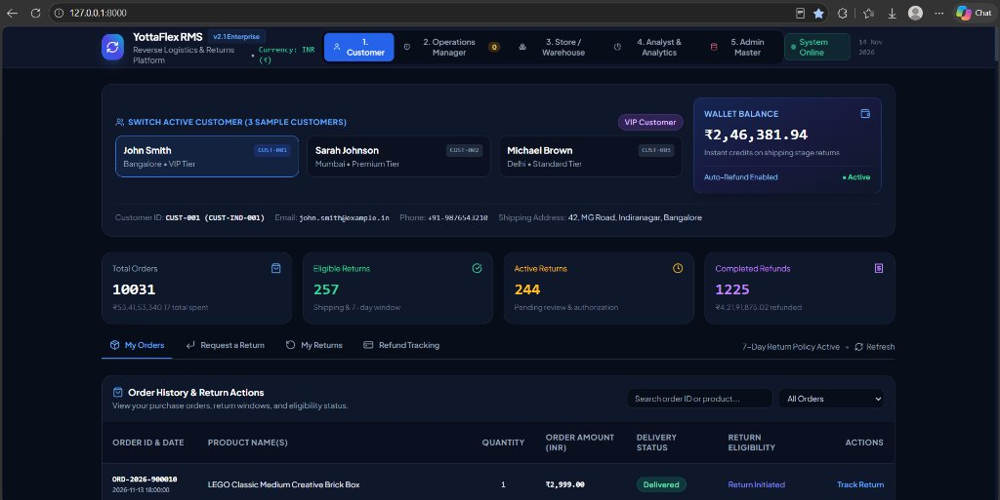
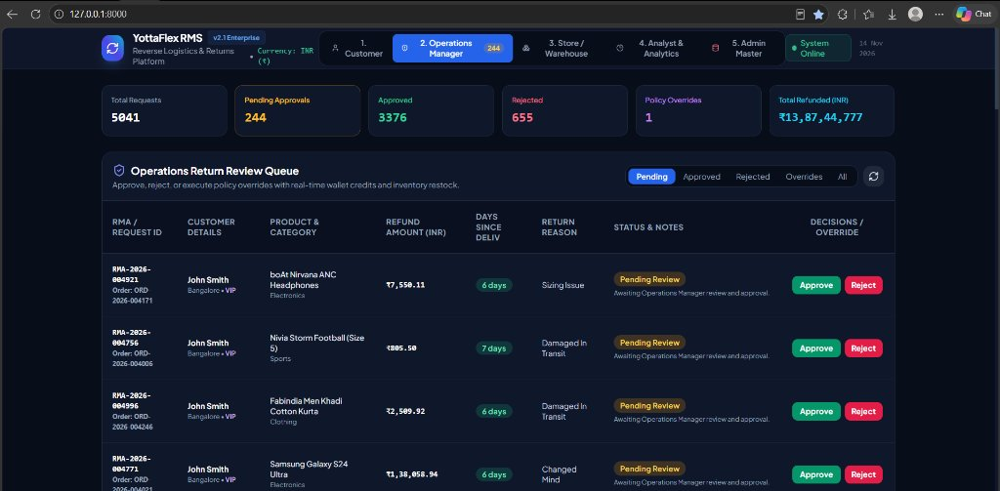
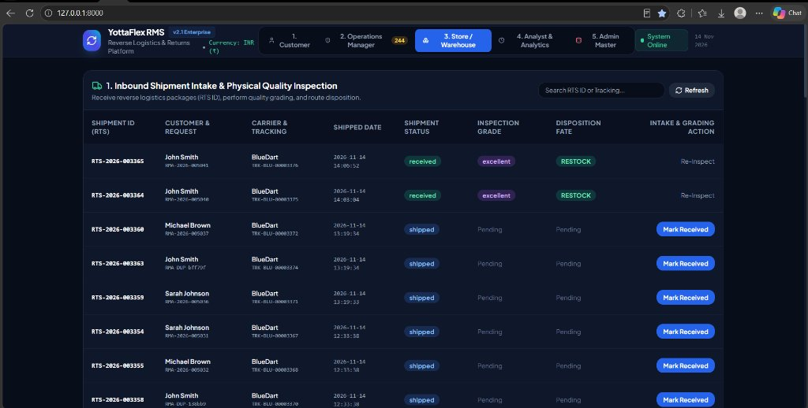
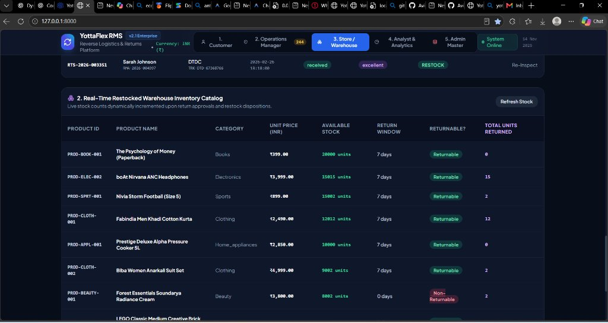
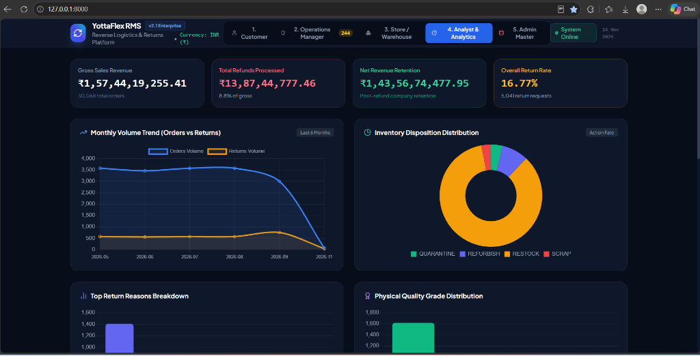
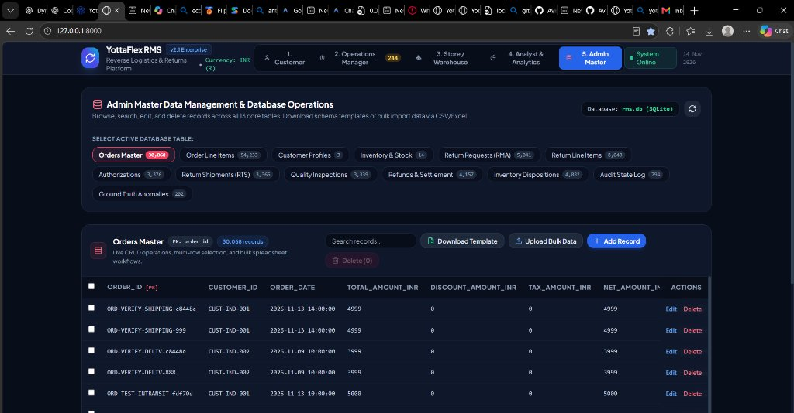

# Returns Management System (RMS) - End-to-End Reverse Logistics & Finance


[](https://v2-yottaflex-rms.onrender.com/)

---

## 🌐 Live Production Deployment

The application is deployed and live on Render:
- 🚀 **Live Web Application**: [YottaFlex RMS - Enterprise Return Management System](https://v2-yottaflex-rms.onrender.com/)
- 📖 **Interactive Swagger API Docs**: [Swagger OpenAPI Specification](https://v2-yottaflex-rms.onrender.com/docs)
- 🔍 **Live System Health Check**: [API Health Endpoint](https://v2-yottaflex-rms.onrender.com/api/v1/health)

---

## Executive Summary

The **Returns Management System (RMS)** is a comprehensive, production-ready, full-stack reverse logistics and financial reconciliation platform built specifically for Indian retail and e-commerce ecosystems.

It solves the core operational challenge: **Managing return eligibility, return authorization, physical inspection, restocking, financial refunds, and inventory disposition with 100% financial traceability in INR (₹).**

### Key Problem Solved & Real-Time Industry Practice Gaps Filled
1. **Interactive Multi-Actor Workflow (5 Enterprise Dashboards)**:
   - **Role 1: Customer Portal**: Switchable dynamically between **3 Sample Customer Profiles**:
     * **Customer 1**: John Smith (`CUST-001` / `CUST-IND-001`, VIP Tier, Starting Wallet: ₹25,000.00)
     * **Customer 2**: Sarah Johnson (`CUST-002` / `CUST-IND-002`, Premium Tier, Starting Wallet: ₹18,500.00)
     * **Customer 3**: Michael Brown (`CUST-003` / `CUST-IND-003`, Standard Tier, Starting Wallet: ₹12,000.00)
     All dashboard metrics, orders, returns, and wallet balances update dynamically upon selection.
   - **Role 2: Operations Manager**: Approval/rejection queue with one-click decision-making, executive policy override for late returns, and automatic accounting ledger adjustments.
   - **Role 3: Store/Warehouse Operator**: Inbound physical shipment intake (`RTS-2026-NNNNNN`), physical inspection quality grading (Grade A, B, C, D), and disposition routing (`Restock`, `Refurbish`, `Quarantine`, `Scrap`).
   - **Role 4: Merchandising/E-Commerce Analyst**: Real-time KPI analytics, financial reconciliation (Gross Revenue vs. Refunds vs. Net Revenue in INR ₹), return reasons breakdown, and ground-truth anomaly detection.
   - **Role 5: Admin Master Dashboard**: Comprehensive database management across all 13 tables, full CRUD (Add/Edit/Delete), downloadable CSV/Excel table templates, and bulk CSV data ingestion.
   - **Live Warehouse Inventory & Financial Ledger**: Real-time stock counts that dynamically decrement upon purchase and update based on physical quality inspection disposition.

2. **Differentiated Business Rules (Real-Time Industry Practices)**:
   - ⚡ **Rule A: In-Transit Returns (Shipping Stage)**:
     - When a customer cancels/returns while the product is still in the `shipping` stage (Return-to-Origin):
     - **Operations approval is NOT required** (Zero-touch automated return)!
     - Immediate refund credited to the customer's wallet.
     - Immediate company revenue deduction.
     - Item automatically added back to active inventory stock.
   - 🛡️ **Rule B: Delivered Items (7-Day Policy Window)**:
     - If `days_since_delivery <= 7`: Customer can raise a return request.
     - Customer is explicitly informed: *"Your return request is raised. Refund will be credited to your wallet once the company/operations manager approves."*
     - Request moves to the **Operations Manager Queue** with status `PENDING_APPROVAL`.
     - Upon Manager Approval: Customer wallet is credited (+₹), Company revenue is deducted (-₹), and item is restocked/routed to disposition.
     - If `days_since_delivery > 7`: Return request is blocked automatically ("Return window expired - past 7 days") unless an authorized manager override is provided.

---

## 📸 Application Screenshots & Interactive Dashboards

### 1. Customer Self-Service Portal (Dynamic 3 Sample Customers)
> Switch seamlessly between **John Smith (VIP)**, **Sarah Johnson (Premium)**, and **Michael Brown (Standard)** with live wallet balance tracking, 7-day return eligibility, and 1-click in-transit cancellations.



---

### 2. Operations Manager Review Queue
> Real-time review queue with pending approval counts, return reasons, days since delivery, 1-click Approve/Reject, and executive policy overrides.



---

### 3. Store / Warehouse Inbound Shipment Intake & Quality Inspection
> Reverse logistics intake (`RTS-2026-NNNNNN`), dock receiving, Grade A–D physical quality grading, and automated disposition routing.



---

### 4. Real-Time Restocked Warehouse Inventory Catalog
> Live stock counts that automatically increment upon approved returns and restock dispositions, showing units returned and returnability flags.



---

### 5. Analyst & Merchandising KPI Analytics Dashboard
> Complete financial reconciliation in INR (₹): Gross Sales Revenue vs Refunds Processed vs Net Retention, monthly volume trends, disposition distribution, and return reasons.



---

### 6. Admin Master Data Management & Database Operations (SQLite Studio)
> Live CRUD operations across all 13 database tables, multi-column search, CSV schema template downloads, and bulk spreadsheet ingestion.



---

## Architecture Diagram

```
┌──────────────────────────────────────────────────────────────────────────┐
│                   RETURNS MANAGEMENT SYSTEM (RMS)                        │
└──────────────────────────────────────────────────────────────────────────┘

     ┌──────────────────────────────────────────────────────────────┐
     │                CUSTOMER INITIATES RETURN                     │
     └──────────────────────────────┬───────────────────────────────┘
                                    │
                    Order Status / Timing Check?
                                    │
          ┌─────────────────────────┴────────────────────────┐
          │                                                  │
    [Shipping Stage]                                [Delivered Stage]
          │                                                  │
          ▼                                                  ▼
 ┌─────────────────────────┐                        Days <= 7 Days?
 │ ZERO-TOUCH AUTO RETURN  │                        ├── Yes ──► Move to Ops Manager Queue
 │ (No Ops Approval Req.)  │                        └── No  ──► Policy Expired (Blocked)
 └────────┬────────────────┘                                         │
          │                                                          ▼
          │                                                 ┌───────────────────┐
          │                                                 │ Operations Manager│
          │                                                 │ Decides Approve / │
          │                                                 │ Reject            │
          │                                                 └─────────┬─────────┘
          │                                                           │
          ├───────────────────────────┬───────────────────────────────┘
          │ (Approved)                │ (Approved)
          ▼                           ▼
 ┌───────────────────┐       ┌────────────────────────┐
 │ Customer Wallet   │       │ Real-Time Company      │
 │ Credited (+₹ INR) │       │ Revenue Deducted (-₹)  │
 └───────────────────┘       └────────────────────────┘
          │
          ▼
 ┌───────────────────┐       ┌────────────────────────┐
 │ Inbound Shipment  │──────►│ Warehouse Inspection   │
 │ (RTS-2026-NNNNNN) │       │ (Quality Grading)      │
 └───────────────────┘       └───────────┬────────────┘
                                         │
                                         ▼
                             ┌────────────────────────┐
                             │ Inventory Disposition  │
                             │ • Restock (+Stock)     │
                             │ • Refurbish (50% rec.) │
                             │ • Quarantine (Vendor)  │
                             │ • Scrap (Write-off)    │
                             └────────────────────────┘
```

---

## Quick Start (Run in 1 Minute)

### ⚙️ Exact Local System Environment & Dependency Versions

To ensure 100% bug-free execution without version mismatches or dependency conflicts, this project is developed and verified against the following verified runtime and package stack:

#### 1. System Runtime Engines
| Component | Verified Version | Notes |
|---|---|---|
| **Operating System** | Windows 10 / 11, macOS, Linux (Ubuntu 22.04+) | Cross-platform compatible |
| **Python** | `3.11.9` (Recommended) / `3.11+` to `3.13.3` | Pinned to `3.11.9` for zero-compile wheels on Render / cloud |
| **Node.js** | `v20.19.4` (Active LTS) | Required only if rebuilding `frontend/` from source |
| **npm** | `10.8.2` | Package manager for React frontend |
| **SQLite** | `3.49.1+` | Embedded serverless database (standard Python `sqlite3` library; zero setup) |

> [!NOTE]
> **Zero External Database Configuration (Self-Contained SQLite 3)**:
> - This application uses an embedded **SQLite 3 database (`data/rms.db`)**.
> - You do **NOT** need to install, configure, or run PostgreSQL, MySQL, or Docker containers.
> - The database comes fully pre-seeded with all 13 relational tables and 30,000+ records.
> - To inspect the live database with a GUI, you can open `data/rms.db` directly in **DBeaver**, **TablePlus**, or **DB Browser for SQLite**.

#### 2. Python Backend Dependencies (`requirements.txt`)
| Library | Version | Purpose |
|---|---|---|
| **`fastapi`** | `0.115.0` | High-performance asynchronous REST API framework |
| **`uvicorn[standard]`** | `0.30.6` | Production ASGI web server engine |
| **`sqlalchemy`** | `2.0.35` | Relational ORM & SQLite database session management |
| **`pydantic`** | `2.9.2` | Data schema validation and strict type serialization |
| **`pydantic-settings`** | `2.5.2` | Application settings and environment configuration |
| **`pandas`** | `2.2.3` | High-speed data manipulation and analytical aggregations |
| **`numpy`** | `1.26.4` | Numerical vector calculations and seed array generation |
| **`faker`** | `30.3.0` | Realistic Indian persona generation (names, cities, addresses) |
| **`python-dateutil`** | `2.9.0.post0`| Date-time arithmetic for 7-day and 14-day policy windows |
| **`httpx`** | `0.27.2` | Async HTTP client for automated test execution |
| **`pytest`** | `8.3.3` | Comprehensive test runner |
| **`aiofiles`** | `23.2.1` | Non-blocking file I/O for reports and CSV exports |
| **`python-multipart`** | `0.0.9` | Form data and CSV file upload handling |

#### 3. Frontend Technology Stack (`frontend/package.json`)
| Package | Version | Purpose |
|---|---|---|
| **`react`** | `^18.3.1` | Core UI component engine |
| **`react-dom`** | `^18.3.1` | DOM renderer for React |
| **`react-router-dom`** | `^6.27.0` | Client-side routing across 5 role dashboards |
| **`vite`** | `^5.4.9` | Modern ultra-fast frontend build tool |
| **`tailwindcss`** | `^3.4.14` | Utility-first responsive CSS styling |
| **`recharts`** | `^2.13.0` | Interactive financial reconciliation & return trends charts |
| **`axios`** | `^1.7.7` | HTTP REST client with error interceptors |
| **`@heroicons/react`** | `^2.1.5` | SVG enterprise icon library |

---

### Step-by-Step Local Setup Guide

#### Option A: One-Command Instant Launch (Pre-built)
The repository comes with the pre-built React frontend in `frontend/dist` and the pre-seeded SQLite database in `data/rms.db`. You can run immediately with Python:

```bash
# 1. Clone repository
git clone https://github.com/Avinashchidurala/V2_YottaFlex-RMS.git
cd V2_YottaFlex-RMS

# 2. (Recommended) Create clean virtual environment
python -m venv venv
# On Windows:
venv\Scripts\activate
# On Linux/macOS:
# source venv/bin/activate

# 3. Install verified dependencies
pip install -r requirements.txt

# 4. Start the application
python run_app.py
```

#### Option B: Rebuilding Frontend from Source (Optional)
If you wish to modify or customize the React UI:
```bash
cd frontend
npm install
npm run build
cd ..
python run_app.py
```

### 3. Open the Interactive Dashboards
- **Web Application**: Open [http://localhost:8000](http://localhost:8000) in any browser.
  - Switch between all 4 actor roles in tabs.
  - Test live wallet updates and instant in-transit cancellations.
  - Approve or reject return requests as Operations Manager.
  - Inspect shipments and route dispositions as Warehouse Operator.
  - View financial ledger and anomaly radar as Analyst.
- **Interactive REST API Docs (Swagger UI)**: Open [http://localhost:8000/docs](http://localhost:8000/docs).

---

## Automated Testing & 100% Reproducibility

### Run the Full Test Suite
Executes unit tests, REST API tests, workflow tests, policy rules, and mathematical reconciliation:
```bash
python run_tests.py
```
*Result: 12/12 tests pass with `OK`.*

### Verify Bitwise Reproducibility (Step 10 Requirement)
Demonstrates that regenerating twice with fixed seed `20261022` produces 100% identical SHA256 checksums across every single dataset:
```bash
python test_reproducibility.py
```
*Result: 14/14 files match 100% bitwise.*

### Regenerate Baseline Synthetic Datasets
Generate full volume (30,000 orders, 5,000 returns, 8,000 return lines, 14 products, 1,000 customers) and run automated validation:
```bash
python run_generator.py --scale 1.0
```

### Seed SQLite Database from CSVs
Loads all generated CSV records into `data/rms.db` respecting relational foreign keys:
```bash
python seed_database.py --clear
```

---

## 3 Core Customer Profiles

| Customer ID | Name | City | Tier | Starting Wallet | Purpose |
|---|---|---|---|---|---|
| `CUST-IND-001` | **Rahul Sharma** | Bangalore | VIP | ₹25,000.00 | Tests in-transit instant cancellations & high-value VIP orders |
| `CUST-IND-002` | **Priya Patel** | Mumbai | Premium | ₹18,500.00 | Tests 7-day delivered return requests & manager approvals |
| `CUST-IND-003` | **Arjun Verma** | Delhi | Standard | ₹12,000.00 | Tests standard policy limits & category return windows |

---

## Synthetic Data Volume & Coverage

| Entity | Primary Key Format | Baseline Volume | Description |
|---|---|---|---|
| **Customer** | `CUST-IND-NNN` | 1,000 | Customers with wallet balances across Indian cities |
| **Inventory** | `PROD-CAT-NNN` | 14 | Products with INR pricing, stock levels, GST %, return windows |
| **Order** | `ORD-2026-NNNNNN` | 30,000 | Purchase transactions (delivered, shipping, confirmed) |
| **OrderLine** | `LINE-ORD-NNNNNN-NN` | ~54,000 | Individual items, quantities, discounts, and GST |
| **ReturnRequest** | `RMA-2026-NNNNNN` | 5,000 | Return requests (auto-approved in-transit, delivered pending) |
| **ReturnLine** | `RMAL-RMA-NNNNNN-NN` | 5,000 | Line-level return items, requested vs approved qty |
| **ReturnAuthorization** | `AUTH-2026-NNNNNN` | 3,370 | 14-day return authorization passes |
| **ReturnShipment** | `RTS-2026-NNNNNN` | 3,370 | Physical transit via BlueDart, Delhivery, DTDC |
| **Inspection** | `INSP-2026-NNNNNN` | 3,350 | Warehouse quality assessment (excellent/good/fair/poor/unusable) |
| **Refund** | `REF-2026-NNNNNN` | 4,135 | Financial reimbursement to customer wallet in INR |
| **InventoryDisposition** | `DISP-2026-NNNNNN` | 4,100 | Fate: Restock, Refurbish, Quarantine, Scrap with recovery INR |
| **StateTransitionLog** | `LOG-2026-NNNNNN` | 750 | Audit trail of status transitions |
| **AnomalyRecord** | `ANOM-2026-NNNNNN` | 200 | Ground-truth labelled negative scenarios in `ground_truth.csv` |

---

## Injected Negative Scenarios / Edge Cases (Ground Truth)

All edge cases are labelled in `data/ground_truth.csv` and never leak into features:

1. **`return_qty_exceeds_purchased`**: Requested return quantity strictly exceeds the original purchased order line quantity.
2. **`refund_exceeds_paid`**: Net refund amount exceeds the total paid amount for the order line.
3. **`restock_before_inspection`**: Inventory disposition timestamp chronologically precedes the inspection timestamp.
4. **`late_return_no_override`**: Return requested after the 7-day policy window has elapsed without an authorized manager override.
5. **`duplicate_refund`**: Duplicate payout attempted for the same return request; flagged and blocked.
6. **`missing_shipment`**: Return shipment marked as lost in transit by the carrier.

---

## REST API & Interactive Swagger Documentation

The application exposes **44 production-grade REST API endpoints** fully documented with OpenAPI 3.0 and interactive Swagger UI.

👉 **Swagger UI (Interactive API Explorer)**: [http://localhost:8000/docs](http://localhost:8000/docs)  
👉 **OpenAPI Schema (Raw JSON)**: [http://localhost:8000/openapi.json](http://localhost:8000/openapi.json)

### Ready-to-Test Real Payload Examples in Swagger

Every endpoint in Swagger UI includes pre-populated, real-data request payloads matching actual records in `data/rms.db`. Simply click **"Try it out"** and **"Execute"** to test live API operations:

#### 1. Customer Portal
- **`POST /api/v1/customer/return-in-transit`** (Rule A: Zero-Touch Instant Cancellation):
  ```json
  {
    "order_id": "ORD-DELIV-CUST001-01",
    "customer_id": "CUST-001",
    "reason": "changed_mind"
  }
  ```
  *Executes instant cancellation: credits John Smith's wallet (+₹) and restocks inventory with zero manager review.*

- **`POST /api/v1/customer/request-return`** (Rule B: 7-Day Delivered Return Request):
  ```json
  {
    "order_id": "ORD-DELIV-CUST001-02",
    "order_line_id": "LINE-DELIV-CUST001-02-01",
    "customer_id": "CUST-001",
    "quantity": 1,
    "reason": "defective",
    "notes": "Device does not power on out of the box. Display remains unresponsive."
  }
  ```
  *Verifies 7-day window, validates category exclusions, and routes to Operations Manager queue.*

#### 2. Operations Management
- **`POST /api/v1/operations/decide`** (Approve / Reject with Policy Override):
  * **Standard Approval**:
    ```json
    {
      "request_id": "RMA-2026-000001",
      "action": "approve",
      "override_policy": false,
      "override_notes": "Standard 7-day policy approval by Operations Manager"
    }
    ```
  * **Executive Policy Override (Late Return Exception)**:
    ```json
    {
      "request_id": "RMA-2026-000002",
      "action": "approve",
      "override_policy": true,
      "override_notes": "Executive override granted for VIP customer John Smith (CUST-001)"
    }
    ```
  * **Rejection with Documented Policy Violation**:
    ```json
    {
      "request_id": "RMA-2026-000003",
      "action": "reject",
      "override_policy": false,
      "rejection_reason": "Return window exceeded (> 14 days) and customer is non-VIP tier."
    }
    ```

#### 3. Warehouse & Disposition
- **`POST /api/v1/warehouse/receive`** (Inbound Dock Intake):
  ```json
  {
    "shipment_id": "RTS-2026-000001"
  }
  ```
- **`POST /api/v1/warehouse/inspect`** (Physical Quality Grading & Disposition):
  * **Grade A &rarr; Restock** (Increments sellable inventory stock):
    ```json
    {
      "shipment_id": "RTS-2026-000001",
      "inspector_id": "INSP-WH-01",
      "quality_grade": "Grade A",
      "overall_condition": "excellent",
      "recommended_action": "restock",
      "notes": "Packaging intact, factory seal verified, all cables present in mint condition.",
      "checklist_passed": true
    }
    ```
  * **Grade C &rarr; Refurbish** (Routes away from sellable stock):
    ```json
    {
      "shipment_id": "RTS-2026-000002",
      "inspector_id": "INSP-WH-02",
      "quality_grade": "Grade C",
      "overall_condition": "fair",
      "recommended_action": "refurbish",
      "notes": "Cosmetic bezel scratch on left side; functional components pass diagnostic test.",
      "checklist_passed": false
    }
    ```
  * **Grade D &rarr; Scrap** (Salvaged/Scrapped):
    ```json
    {
      "shipment_id": "RTS-2026-000003",
      "inspector_id": "INSP-WH-03",
      "quality_grade": "Grade D",
      "overall_condition": "unusable",
      "recommended_action": "scrap",
      "notes": "Water ingress damage and shattered chassis. Zero salvageable components.",
      "checklist_passed": false
    }
    ```

#### 4. Admin Master CRUD
- **`POST /api/v1/admin/table/customers/record`** (Manual Record Creation):
  ```json
  {
    "customer_id": "CUST-IND-099",
    "name": "Karan Malhotra",
    "email": "karan.malhotra@example.in",
    "phone": "+91 98765 43210",
    "city": "Hyderabad",
    "state": "Telangana",
    "tier": "Premium",
    "wallet_balance_inr": 15000.0
  }
  ```
- **`PUT /api/v1/admin/table/inventory/record`** (Update Stock by Primary Key):
  ```json
  {
    "product_id": "PROD-ELEC-001",
    "stock_quantity": 300,
    "unit_price_inr": 129999.0
  }
  ```
- **`DELETE /api/v1/admin/table/orders/record`** (Bulk Delete):
  ```json
  {
    "pk_values": ["ORD-DELIV-CUST001-09", "ORD-DELIV-CUST001-10"]
  }
  ```

---

## REST API Endpoints Overview

| Tag | Method | Endpoint | Description |
|---|---|---|---|
| **System Health** | `GET` | `/api/v1/health` | Health check, DB file path & system time |
| **Customer Portal** | `GET` | `/api/v1/customers` | List customers (including 3 core sample profiles) |
| **Customer Portal** | `GET` | `/api/v1/customer/{customer_id}/summary` | Customer profile, total spent, active returns & wallet balance (₹) |
| **Customer Portal** | `GET` | `/api/v1/customer/{customer_id}/orders` | Customer order history with 7-day policy eligibility check |
| **Customer Portal** | `GET` | `/api/v1/customer/{customer_id}/returns` | Customer returns list with carrier RTS tracking number |
| **Customer Portal** | `GET` | `/api/v1/customer/{customer_id}/refunds` | Customer wallet refund transaction history in INR (₹) |
| **Customer Portal** | `POST` | `/api/v1/customer/return-in-transit` | **Rule A**: Zero-touch auto return for shipping stage orders |
| **Customer Portal** | `POST` | `/api/v1/customer/request-return` | **Rule B**: Submit delivered item return (7-day window) |
| **Operations** | `GET` | `/api/v1/operations/requests` | Operations return queue (filterable by pending, approved, rejected, overrides) |
| **Operations** | `GET` | `/api/v1/operations/pending-requests` | Fetch pending return requests queue for Operations Manager |
| **Operations** | `POST` | `/api/v1/operations/decide` | Approve or reject return request (with policy override support) |
| **Warehouse** | `GET` | `/api/v1/warehouse/shipments` | List inbound return shipments (`RTS-2026-NNNNNN`) |
| **Warehouse** | `POST` | `/api/v1/warehouse/receive` | Mark inbound RTS shipment as received at warehouse dock |
| **Warehouse** | `POST` | `/api/v1/warehouse/inspect` | Record quality inspection (Grade A–D) & disposition routing |
| **Warehouse** | `GET` | `/api/v1/inventory` | Real-time warehouse product stock catalog |
| **Analytics** | `GET` | `/api/v1/dashboard/metrics` | Executive financial ledger: Gross Revenue, Refunds, Net Revenue (₹) |
| **Analytics** | `GET` | `/api/v1/dashboard/return-trends` | Monthly return trends vs orders |
| **Analytics** | `GET` | `/api/v1/dashboard/disposition-breakdown` | Disposition distribution (Restock, Refurbish, Scrap) |
| **Analytics** | `GET` | `/api/v1/dashboard/anomalies` | Ground-truth policy and fraud anomaly radar |
| **Admin Master** | `GET` | `/api/v1/admin/tables` | List all 13 database tables and live row counts |
| **Admin Master** | `GET` | `/api/v1/admin/table/{table_name}` | Query paginated table records with multi-column text search |
| **Admin Master** | `POST` | `/api/v1/admin/table/{table_name}/record` | Insert new record manually into database table |
| **Admin Master** | `PUT` | `/api/v1/admin/table/{table_name}/record` | Update existing record by primary key |
| **Admin Master** | `DELETE` | `/api/v1/admin/table/{table_name}/record` | Delete single record or bulk records |
| **Admin Master** | `GET` | `/api/v1/admin/template/{table_name}` | Download pre-filled CSV table template with sample row |
| **Admin Master** | `POST` | `/api/v1/admin/upload/{table_name}` | Bulk upload and ingest CSV data directly into database |

---

## Lawful Provenance & License

- **Synthetic Data**: 100% synthetically generated via deterministic PRNG algorithms using fixed seed `20261022`. No private or copyright-protected data collected.
- **License**: MIT Open Source License.
